# ScienceQtech Employee Performance Mapping

A MySQL project that designs a relational database for employee data and uses SQL to analyse ratings, experience, salary, project assignments and bonuses.

  

---

## Table of Contents
- [Overview](#overview)
- [Objectives](#objectives)
- [Tech Stack](#tech-stack)
- [Dataset](#dataset)
- [Database Design](#database-design)
- [Repository Structure](#repository-structure)
- [How to Run](#how-to-run)
- [SQL Queries and Analysis](#sql-queries-and-analysis)
- [Key SQL Concepts Used](#key-sql-concepts-used)
- [Conclusion](#conclusion)

---

## Overview

This project uses the ScienceQtech employee dataset to explore employee details, department-wise performance, salary distribution, experience levels, project assignments and ratings. MySQL is used to create the database, define table relationships, and run queries for data retrieval and analysis.

## Objectives

- Create and organise a relational database in MySQL.
- Import the supplied CSV files into their tables.
- Understand table relationships using primary keys, foreign keys and an ER diagram.
- Retrieve and filter data using `SELECT`, `WHERE` and `UNION`.
- Analyse ratings, experience and salary using aggregate and window functions.
- Apply joins, nested queries, views, stored procedures, stored functions and indexes.
- Calculate employee bonuses and average salary by country and continent.

## Tech Stack

| Tool | Purpose |
|------|---------|
| MySQL | Relational database to store and query data |
| MySQL Workbench | CSV import, SQL execution, ER diagram creation |
| SQL | Defining, retrieving and analysing data |
| CSV files | Source data for employees, projects and the data science team |

## Dataset

The database has three tables:

| Table | Description |
|-------|-------------|
| `emp_record_table` | Employee ID, name, gender, role, department, experience, country, continent, salary, rating, manager ID, project ID |
| `proj_table` | Project information, identified by `PROJECT_ID` |
| `data_science_team` | Employee details and roles for the data science team (a subset of employees) |

## Database Design

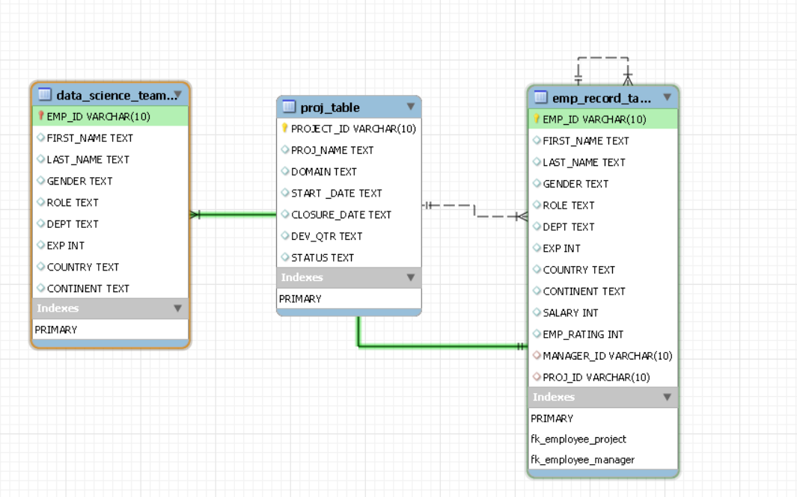

The ER diagram was generated in MySQL Workbench using **Database > Reverse Engineer**.

**Relationships**
- **Project to employee:** `proj_table.PROJECT_ID` (PK) is referenced by `emp_record_table.PROJ_ID` (FK). One project can have many employees.
- **Manager self-reference:** `emp_record_table.MANAGER_ID` references `emp_record_table.EMP_ID`. One manager can have many direct reports.
- **Employee to data science team:** `data_science_team.EMP_ID` is both a PK and an FK referencing `emp_record_table.EMP_ID`.

## Repository Structure

```
.
├── README.md
├── employee_queries.sql
├── data/
│   ├── emp_record_table.csv
│   ├── proj_table.csv
│   └── data_science_team.csv
└── images/
    ├── er_diagram.png
    └── q1_*.png, q3.png ... q17.png  (query output screenshots)
```

## How to Run

1. Install MySQL and MySQL Workbench.
2. Create the database:
   ```sql
   CREATE DATABASE employee;
   USE employee;
   ```
3. Import the three CSV files from `data/` into matching tables using **Workbench > Table Data Import Wizard**.
4. Open `employee_queries.sql` in Workbench and run the queries one by one.

---

## SQL Queries and Analysis

### Q1. Create the database and import CSV files

The CSV files are imported with the Workbench Table Data Import Wizard (not with SQL `INSERT`).

```sql
CREATE DATABASE employee;
USE employee;
-- Import the CSV files using MySQL Workbench: Table Data Import Wizard
-- emp_record_table.csv
-- proj_table.csv
-- data_science_team.csv
```

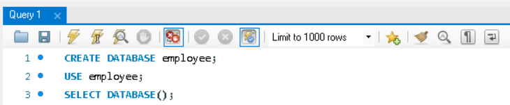
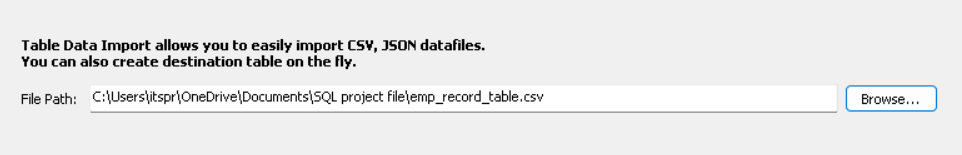
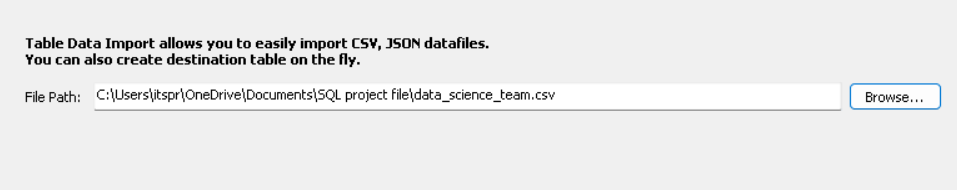
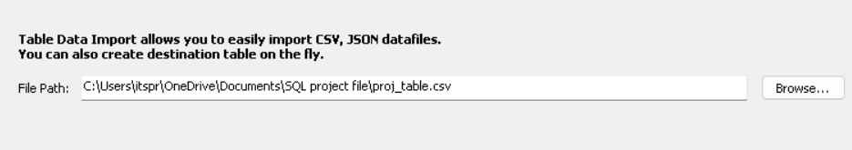

### Q2. ER diagram

Created using MySQL Workbench's Reverse Engineer feature. See the [Database Design](#database-design) section.

### Q3. Fetch employee ID, name, gender and department

```sql
SELECT
    EMP_ID,
    FIRST_NAME,
    LAST_NAME,
    GENDER,
    DEPT AS DEPARTMENT
FROM emp_record_table;
```

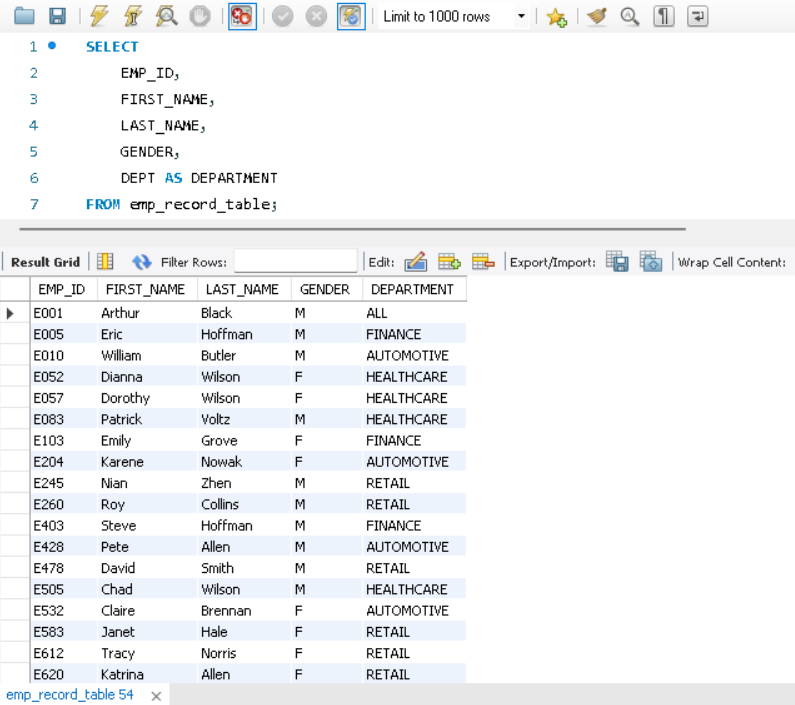

### Q4. Fetch employees based on rating

Three filters: rating below 2, above 4, and between 2 and 4 (inclusive).

```sql
-- Rating less than 2
SELECT EMP_ID, FIRST_NAME, LAST_NAME, GENDER, DEPT AS DEPARTMENT, EMP_RATING
FROM emp_record_table
WHERE EMP_RATING < 2;

-- Rating greater than 4
SELECT EMP_ID, FIRST_NAME, LAST_NAME, GENDER, DEPT AS DEPARTMENT, EMP_RATING
FROM emp_record_table
WHERE EMP_RATING > 4;

-- Rating between 2 and 4 (inclusive)
SELECT EMP_ID, FIRST_NAME, LAST_NAME, GENDER, DEPT AS DEPARTMENT, EMP_RATING
FROM emp_record_table
WHERE EMP_RATING BETWEEN 2 AND 4;
```

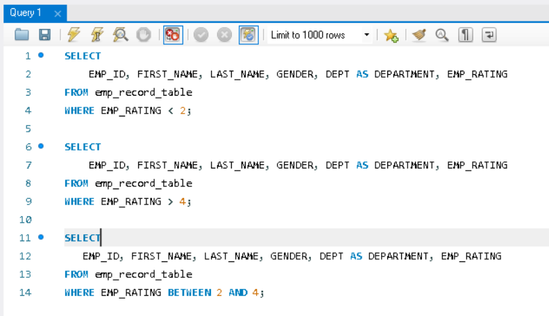
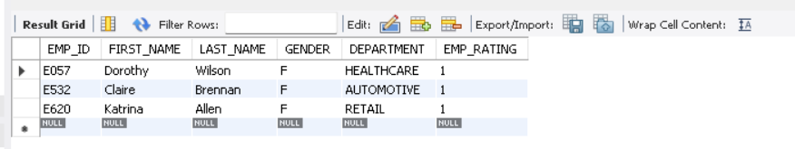
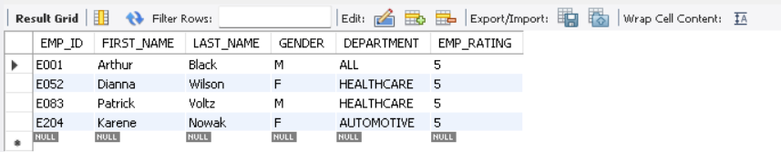
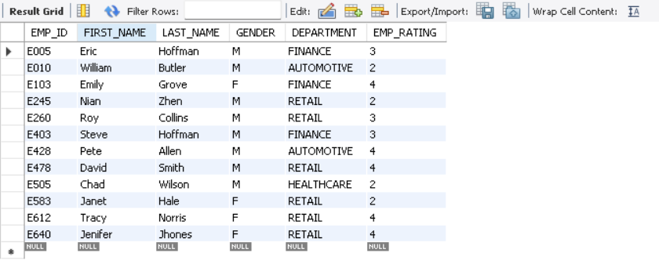

### Q5. Concatenate first and last names of Finance employees

```sql
SELECT CONCAT(FIRST_NAME, ' ', LAST_NAME) AS NAME
FROM emp_record_table
WHERE DEPT = 'Finance';
```

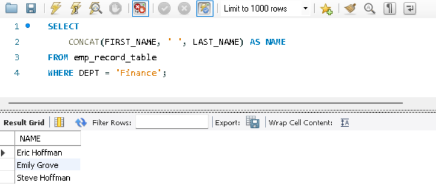

### Q6. List managers and count their reporters

A self-join matches each manager to their direct reports. `INNER JOIN` returns only managers with at least one report.

```sql
SELECT
    manager.EMP_ID,
    manager.FIRST_NAME,
    manager.LAST_NAME,
    COUNT(employee.EMP_ID) AS NUMBER_OF_REPORTERS
FROM emp_record_table AS manager
INNER JOIN emp_record_table AS employee
    ON manager.EMP_ID = employee.MANAGER_ID
GROUP BY
    manager.EMP_ID,
    manager.FIRST_NAME,
    manager.LAST_NAME;
```

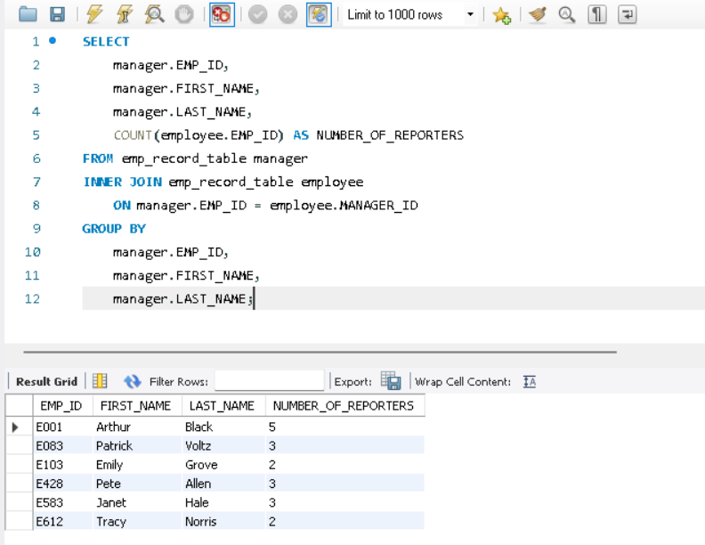

### Q7. Employees from Healthcare and Finance using UNION

`UNION` removes duplicate rows from the combined result.

```sql
SELECT EMP_ID, FIRST_NAME, LAST_NAME, GENDER, DEPT
FROM emp_record_table
WHERE DEPT = 'Healthcare'
UNION
SELECT EMP_ID, FIRST_NAME, LAST_NAME, GENDER, DEPT
FROM emp_record_table
WHERE DEPT = 'Finance';
```

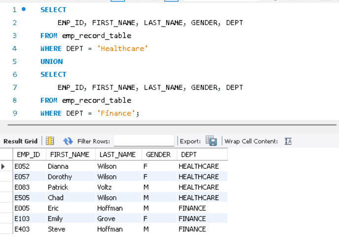

### Q8. Maximum rating in each department (window function)

`MAX()` with `PARTITION BY DEPT` keeps every employee row and shows the department's maximum rating beside it.

```sql
SELECT
    EMP_ID,
    FIRST_NAME,
    LAST_NAME,
    ROLE,
    DEPT AS DEPARTMENT,
    EMP_RATING,
    MAX(EMP_RATING) OVER (PARTITION BY DEPT) AS MAX_DEPT_RATING
FROM emp_record_table;
```

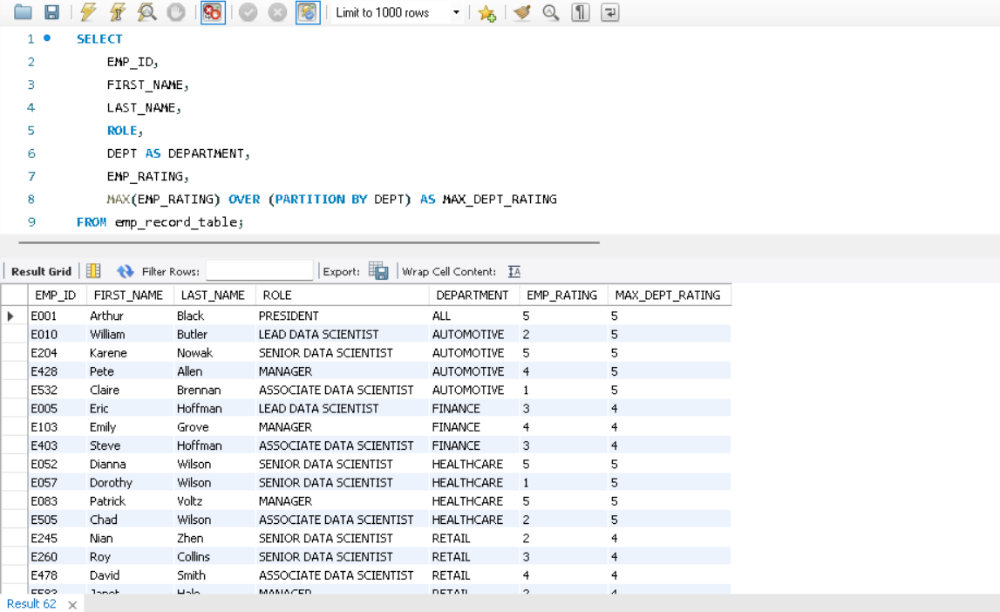

### Q9. Minimum and maximum salary for each role

```sql
SELECT
    ROLE,
    MIN(SALARY) AS MIN_SALARY,
    MAX(SALARY) AS MAX_SALARY
FROM emp_record_table
GROUP BY ROLE;
```

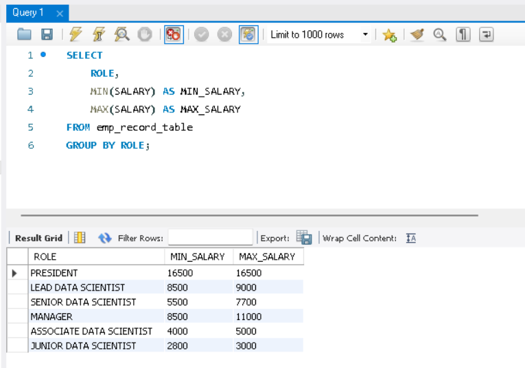

### Q10. Rank employees by experience

`RANK()` gives equal experience the same rank.

```sql
SELECT
    EMP_ID,
    FIRST_NAME,
    LAST_NAME,
    EXP,
    RANK() OVER (ORDER BY EXP DESC) AS EXPERIENCE_RANK
FROM emp_record_table;
```

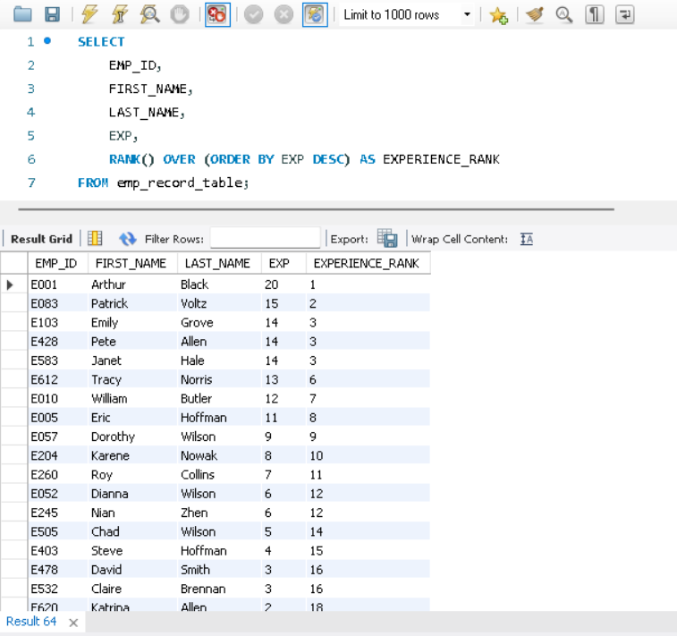

### Q11. View for employees earning more than 6,000

```sql
CREATE OR REPLACE VIEW high_salary_employees AS
SELECT *
FROM emp_record_table
WHERE SALARY > 6000;

SELECT *
FROM high_salary_employees;
```

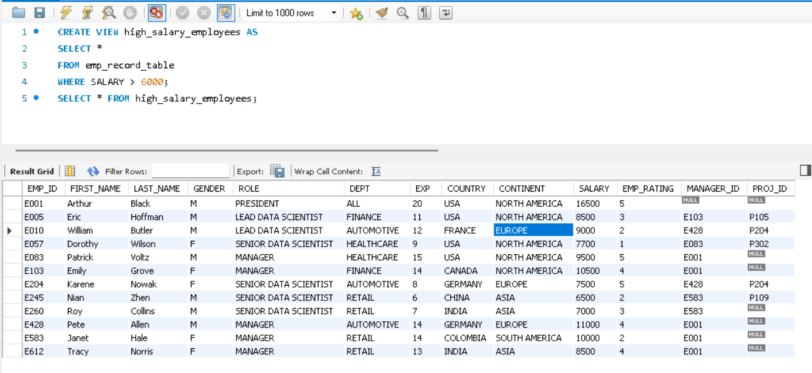

### Q12. Employees with more than 10 years of experience (nested query)

```sql
SELECT *
FROM emp_record_table
WHERE EMP_ID IN (
    SELECT EMP_ID
    FROM emp_record_table
    WHERE EXP > 10
);
```

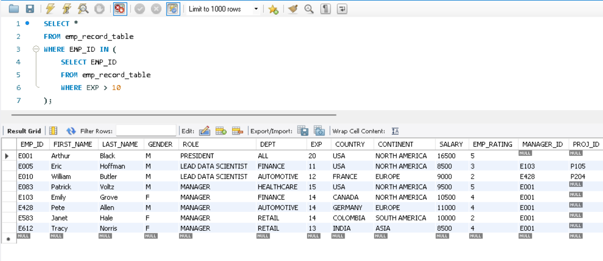

### Q13. Stored procedure for employees with more than 3 years of experience

```sql
DELIMITER //
CREATE PROCEDURE GetExperiencedEmployees()
BEGIN
    SELECT *
    FROM emp_record_table
    WHERE EXP > 3;
END //
DELIMITER ;

CALL GetExperiencedEmployees();
```

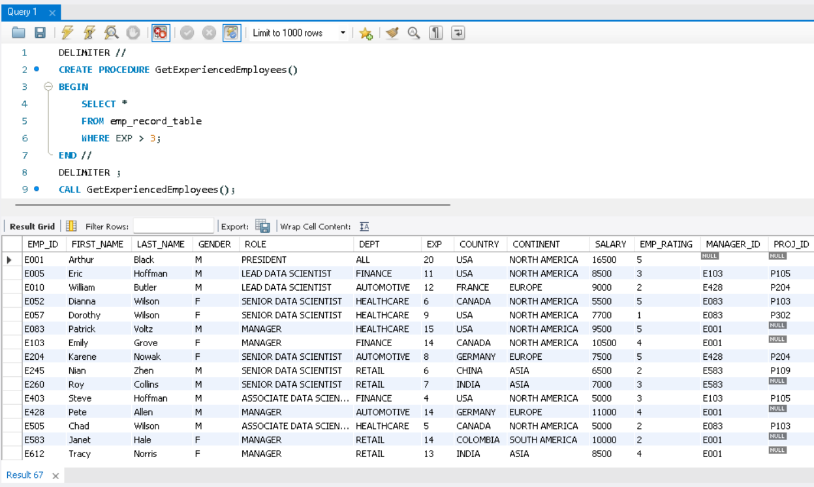

### Q14. Check data science team roles against the experience standard (stored function)

Experience bands used by the function:

| Experience (years) | Standard role |
|--------------------|---------------|
| up to 2 | JUNIOR DATA SCIENTIST |
| over 2 to 5 | ASSOCIATE DATA SCIENTIST |
| over 5 to 10 | SENIOR DATA SCIENTIST |
| over 10 to 12 | LEAD DATA SCIENTIST |
| over 12 to 16 | MANAGER |
| over 16 | OUT OF RANGE |

```sql
DELIMITER //
CREATE FUNCTION GetStandardRole(exp INT)
RETURNS VARCHAR(50)
DETERMINISTIC
BEGIN
    DECLARE standard_role VARCHAR(50);
    IF exp <= 2 THEN
        SET standard_role = 'JUNIOR DATA SCIENTIST';
    ELSEIF exp <= 5 THEN
        SET standard_role = 'ASSOCIATE DATA SCIENTIST';
    ELSEIF exp <= 10 THEN
        SET standard_role = 'SENIOR DATA SCIENTIST';
    ELSEIF exp <= 12 THEN
        SET standard_role = 'LEAD DATA SCIENTIST';
    ELSEIF exp <= 16 THEN
        SET standard_role = 'MANAGER';
    ELSE
        SET standard_role = 'OUT OF RANGE';
    END IF;
    RETURN standard_role;
END //
DELIMITER ;

SELECT
    EMP_ID,
    FIRST_NAME,
    LAST_NAME,
    EXP,
    ROLE AS ASSIGNED_ROLE,
    GetStandardRole(EXP) AS STANDARD_ROLE,
    CASE
        WHEN UPPER(TRIM(ROLE)) = GetStandardRole(EXP)
        THEN 'MATCH'
        ELSE 'MISMATCH'
    END AS STATUS
FROM data_science_team;
```

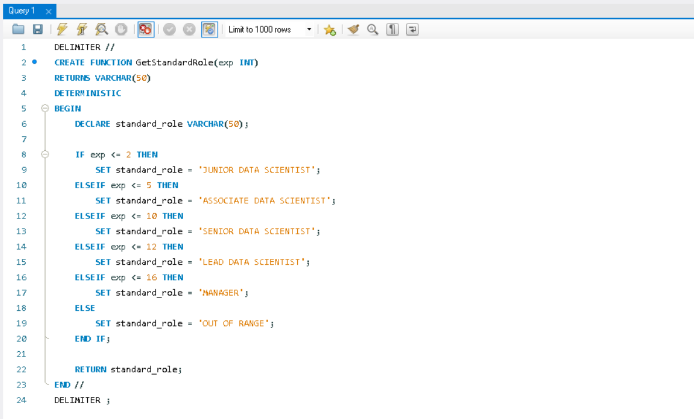
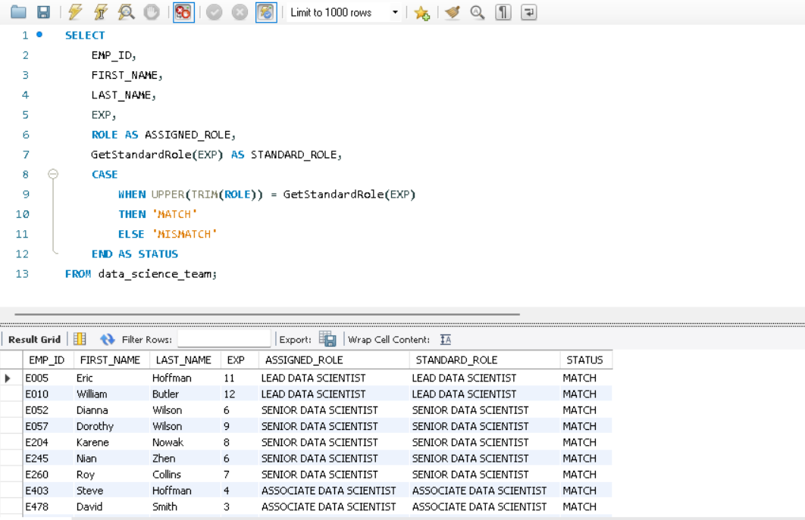

### Q15. Index to speed up first-name lookups

`FIRST_NAME` is a `TEXT` column, so a prefix index on the first 50 characters is used. `EXPLAIN` is run before and after to compare execution plans.

```sql
-- Before creating the index
EXPLAIN
SELECT *
FROM emp_record_table
WHERE FIRST_NAME = 'Eric';

-- Create a prefix index
CREATE INDEX idx_first_name
ON emp_record_table (FIRST_NAME(50));

-- After creating the index
EXPLAIN
SELECT *
FROM emp_record_table
WHERE FIRST_NAME = 'Eric';
```

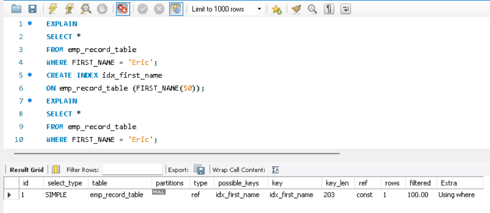

After the index, the execution plan shows `idx_first_name` in the `key` column with `type = ref` and `rows = 1`, so MySQL no longer scans the whole table.

### Q16. Calculate employee bonus

Bonus = 5% of salary × employee rating.

```sql
SELECT
    EMP_ID,
    FIRST_NAME,
    LAST_NAME,
    SALARY,
    EMP_RATING,
    (SALARY * 0.05 * EMP_RATING) AS BONUS
FROM emp_record_table;
```

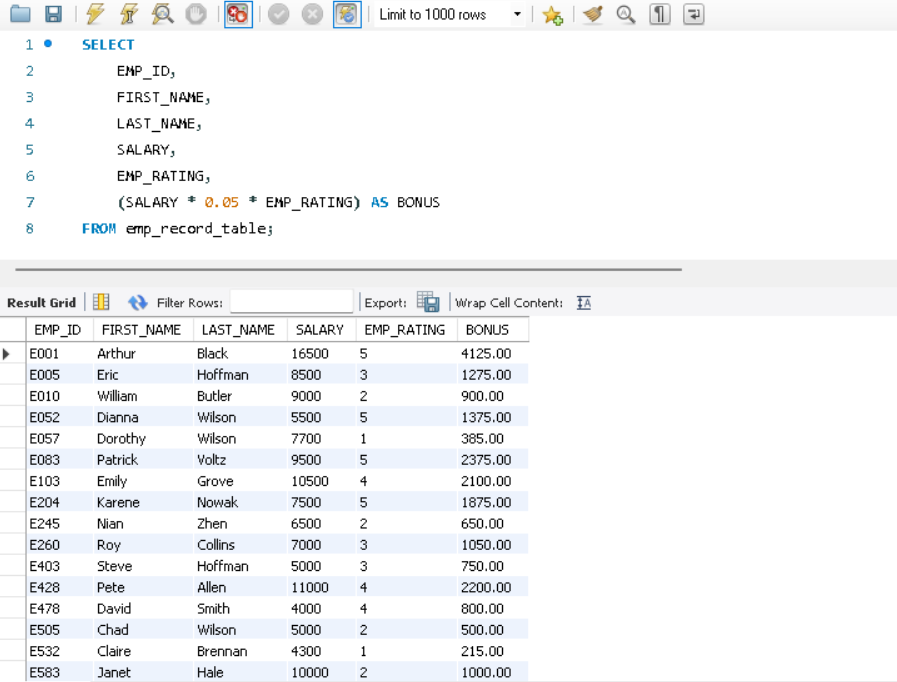

### Q17. Average salary by continent and country

```sql
SELECT
    CONTINENT,
    COUNTRY,
    AVG(SALARY) AS AVERAGE_SALARY
FROM emp_record_table
GROUP BY CONTINENT, COUNTRY
ORDER BY CONTINENT, COUNTRY;
```

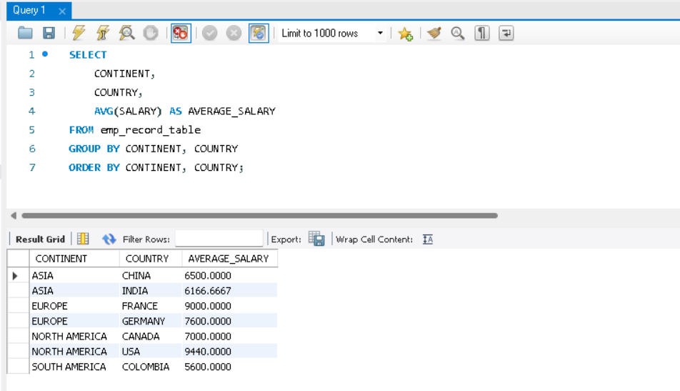

---

## Key SQL Concepts Used

- Database creation and CSV import
- Primary keys, foreign keys and ER modelling
- Filtering with `WHERE`, `BETWEEN`, `IN`
- String functions (`CONCAT`, `UPPER`, `TRIM`)
- Self-join with `INNER JOIN`
- `UNION`
- Aggregate functions (`MIN`, `MAX`, `AVG`, `COUNT`) with `GROUP BY`
- Window functions (`MAX() OVER`, `RANK() OVER`)
- Views
- Nested queries (subqueries)
- Stored procedures and stored functions
- `CASE` expressions
- Indexing and `EXPLAIN`

## Conclusion

This project gave practical experience in creating and managing a relational database with MySQL, from setup and CSV import to ER modelling, advanced queries, stored routines and indexing. The final queries show how employee performance, salary and experience data can be organised and analysed to produce useful insights.

---

## Author

**Prakash**
[GitHub](https://github.com/itsprakashpoojary) | [LinkedIn](https://www.linkedin.com/in/itsprakashpoojary)
